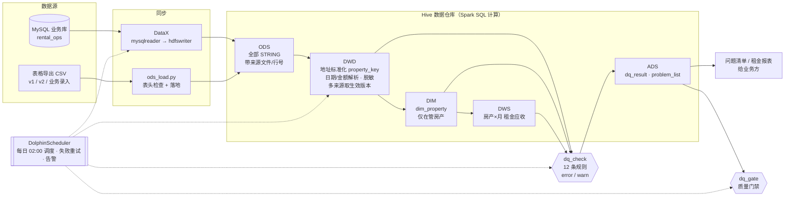

# rental-dq-bigdata：租赁业务数据仓库与数据质量平台（Hive + Spark + DataX + DolphinScheduler）

个人项目。业务场景来自我在实习中做的数据校验工作：物业公司的房产、租约、水费、房屋检查数据分散在多个版本的表格和业务系统里，地址写法不统一、版本之间互相冲突、日期格式混乱，业务方无法信任报表。

这个仓库用**合成数据**（不含任何真实信息）和国内常用的大数据技术栈重新实现了这套流程：分层建模 + 规则化的数据质量检查 + 质量门禁 + 给业务方的问题清单闭环。

> 我的另一个版本（dbt + PostgreSQL / Airflow / Snowflake）：[li-iris/rental-dwh-dbt](https://github.com/li-iris/rental-dwh-dbt)

## 架构



## 分层设计

| 层 | 表 | 说明 |
|---|---|---|
| ODS | `ods_property` `ods_tenancy` `ods_water_bill` `ods_inspection` | 原样落地，所有字段存 STRING，附 `src_file` / `src_row_no` / `load_ts`，每一行都能追回源头；TEXTFILE，按 `dt` 分区 |
| DWD | `dwd_*_df` | 每日全量快照。地址统一成 `property_key`（单元号/门牌/街道，街道拼写错误用 `conf/street_token_fixes.csv` 修正）；日期、金额解析；租客姓名 SHA-256 脱敏；**不删行**，解析不了的字段置空并记录状态 |
| DIM | `dim_property` | 只有在管房产建维度，`property_id = md5(property_key)`；其他表只关联、不新建 |
| DWS | `dws_rent_roll_month` | 房产 × 月的租金应收。租金口径（整套 / 单间 / 多租约）按业务阈值判断，**说不清时标记 unclear，不硬算** |
| ADS | `ads_dq_result` `ads_problem_list` | 每条规则的失败行数（按天分区即历史趋势）+ 失败明细 |

## 数据质量规则（`conf/dq_rules.json`）

每条规则是一段返回"失败行"的 SQL，新增规则只改配置、不改代码。业务参数（阈值、天数）集中在 `conf/business_rules.json`，由业务方决定数值。

| 级别 | 含义 | 规则 |
|---|---|---|
| **error** | 数据坏了，门禁不放行 | E01 ODS→DWD 不丢行 · E02 租期倒置 · E03 租约房产在维度中找不到 · E04 租金≤0 · E05 水费金额缺失/为负 · E06 账单重复 |
| **warn** | 业务需要跟进，进入问题清单 | W01 水费超 90 天未开票 · W02 检查通知不足 7 天 · W03 年例行检查超 4 次 · W04 租金口径不清 · W05 地址无法解析 · W06 日期无法解析 |

几个关键处理：
- **多版本冲突**：同一租约可能同时出现在 v1、v2 和业务录入表里，按 `source_priority`（业务录入 99 最高）取生效版本，其余行保留并标记 `is_current = 0`，可追溯。
- **只写了"日.月"的日期**：只有能给出规则时才补年份——取离锚点日期最近、且不晚于锚点 + 60 天的年份（通知日期以检查日期为锚点）；没有锚点就置空并报 W06，不猜。
- **表头检查**：源文件表头和 `conf/sources.json` 对不上（有人插了一列）就直接中止，一行都不写。
- **质量门禁**：`dq_check` 只负责检查和记录；`dq_gate` 发现 error 级问题时退出码为 2，调度系统判失败并告警，下游不放行。问题清单照常导出，业务方填写"业务方回复 / 是否已处理"后回传，形成闭环。
- **可重跑**：所有写入都是 `INSERT OVERWRITE ... PARTITION (dt=...)`，重跑同一天结果一致；`--report-date` 可回放历史某天的逾期判断。

## 目录

```
conf/               业务参数、源定义、DQ 规则、街道纠错表
sql/hive/           Hive 建表 DDL（ODS / DWD / DIM / DWS / ADS）
spark_jobs/         PySpark 作业：ods_load → dwd_clean → dim_dws → dq_check → ads_export → dq_gate
spark_jobs/lib/     纯 Python 业务规则（地址、日期、金额、租金口径），注册成 UDF，单元测试覆盖
datax/              MySQL 源表结构 + DataX 同步任务（mysqlreader → hdfswriter）
dolphinscheduler/   工作流定义（PyDolphinScheduler）
data_gen/           合成数据生成（可选注入 error 演示门禁）
scripts/            本地一键运行、单步运行、DataX 运行、macOS 环境安装
tests/              单元测试
```

## 本地运行（macOS）

本地模式用 Spark 自带的 Hive 支持（Derby 元数据库，表落在 `./warehouse`），不需要装 Hadoop / Hive 集群。

```bash
# 1. 环境：Java 17 + Python 虚拟环境 + PySpark 3.5
bash scripts/setup_mac.sh
source .venv/bin/activate && export JAVA_HOME=$(/usr/libexec/java_home -v 17)

# 2. 单元测试
python -m pytest tests -v

# 3. 跑通全流程（只有 warn，退出码 0）
bash scripts/run_pipeline.sh 2026-11-02

# 4. 注入 error 演示质量门禁（退出码 2）
bash scripts/run_pipeline.sh 2026-11-03 --with-errors
```

结果在 `output/`：`problem_list_<dt>.csv`（问题清单）、`dq_summary_<dt>.csv`（规则汇总）、`rent_roll_<月>.csv`（租金应收），日志在 `logs/`。

查表：
```bash
python - <<'EOF'
import sys; sys.path.insert(0, "spark_jobs")
from common import get_spark
spark = get_spark("query")
spark.sql("SELECT rule_id, level, fail_cnt FROM ads.ads_dq_result WHERE dt='2026-11-02'").show(truncate=False)
spark.sql("SELECT rent_basis, count(*) FROM dws.dws_rent_roll_month WHERE dt='2026-11-02' GROUP BY rent_basis").show()
EOF
```

## 集群部署

- DataX：`bash scripts/run_datax.sh <dt>`（需设置 `DATAX_HOME` `MYSQL_HOST` `MYSQL_USER` `MYSQL_PASSWORD` `NAMENODE`），同步完成后给 ODS 表加分区。
- Spark：`SPARK_ON_YARN=1 bash scripts/run_step.sh <作业> <dt>`，以 `spark-submit --master yarn` 提交，读写集群 Hive Metastore。
- 调度：`python dolphinscheduler/workflow_rental_dq.py` 提交工作流 `rental_dq_daily`，每天 02:00 处理 T-1 数据，失败重试，`dq_gate` 失败触发告警。
